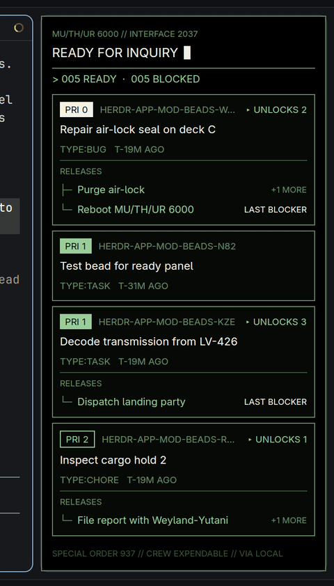

# beads-ready — a Nostromo terminal for your ready beads

A mod for the [herdr-app](https://herdr.dev) window. It hangs a panel on the right that lists the **ready
[beads](https://github.com/steveyegge/beads)** of the project in the focused pane, drawn as the MU/TH/UR 6000
terminal from *Alien* (1979). Click a bead to see its full dependency chain, and spawn a
[vega](https://herdr.dev) sentinel for it.



Two mods live in this repository:

| Mod | What it is |
| --- | --- |
| `mods/beads-ready/` | The panel on the right: ready beads, blocked queue, dependency edges. |
| `mods/beads-detail/` | The dialog it opens for one bead: record, full dependency tree, sentinel button. |

## Features

- **Ready beads.** Runs `beads ready --json` and `beads blocked --json`, every 5 s and whenever the focused folder
  changes. Needs `beads` >= 1.3. If it is missing or older, the panel only shows an info box and does nothing else.
- **A graph, not a list.** Each ready bead shows `▸ UNLOCKS n` (everything it transitively releases) and a
  `RELEASES` tree. A framed **blocked queue** lists what each blocked bead `WAITS ON`.
- **Detail dialog.** Click a bead or any dependency row. It shows the record plus the *full* chain in both directions
  (`beads dep tree`), every row clickable. `Backspace` or `◂ BACK` goes back, `Esc` closes.
  Click the bead id to copy it. The alien-head button closes the view (tooltip: *close view*).
- **Spawn vega sentinel.** The skull button asks first (`PUSH` / `PULL`), then runs
  `vega mux spawn sentinel-<id> --kind claude --tier balanced --no-parent --prompt-file …` with a brief built from
  the bead. vega starts Claude without permission prompts, which is why there is a confirmation step.
- **Priority by weight, not hue.** Red, yellow, green and blue are kept for status.
- **The CRT takes a shock** now and then: tearing rows, corrupted glyphs, a flash. Trigger one with
  `herdr-app do beads-ready.shock`.

## Design

After the film, as described in
[Typeset in the Future: Alien](https://typesetinthefuture.com/2014/12/01/alien/):

- Helvetica for title cards and labels (set in *Nimbus Sans*, a Helvetica clone), a serif (*Noto Serif*) for
  MU/TH/UR's own words, mono for ids.
- A "foreshadowing inventory" card (`VESSEL`, `CREW`, `CARGO`, `NEXT`) before the work.
- Ron Cobb's semiotic standard: a pictogram in a rounded rectangle for each bead type.
- English and French labels, as on the self-destruct panel (`RELEASES / LIBÈRE`, `WAITS ON / ATTEND`).
- A boot sequence on start, and a `PUSH` / `PULL` confirmation for the sentinel.
- Colours from [b4mad.industries](https://b4mad.industries/): black, sage `#698b69`, light sage `#9bcd9b`,
  cream `#f4f1e8`, orange on hover.

The three fonts are not bundled; install them or herdr-app falls back to its default font.

## Requirements

- [herdr-app](https://herdr.dev) with its mod support (`herdr-app check`, `herdr-app do layout.clone`).
- `beads` (`bd`) >= 1.3 on the machine, or in a toolbox container (see below).
- For the sentinel button: `vega` with its `mux` plugin.

## Install

```sh
cp -r mods/beads-ready mods/beads-detail ~/.config/herdr-app/mods/
herdr-app check ~/.config/herdr-app/mods/beads-ready
herdr-app check ~/.config/herdr-app/mods/beads-detail
```

herdr-app's shipped `main` layout is read-only and does not dock the panel by itself. Clone it and add a block next to
the `main` block inside `work-body`:

```sh
herdr-app do layout.clone '{"name":"main","as":"main-beads"}'
```

```json
{ "id": "beads", "type": "block", "size": { "px": 320 }, "min": 220, "max": 700,
  "background": "surface", "radius": 10, "border": { "width": 1, "color": "border" },
  "content": { "mod": "beads-ready" } }
```

(`layouts/main-beads.json`, under *work-body → children*.) The mods reload when you save.

## Configuration

There are no settings files; the constants sit at the top of the two `main.js` files:

| Constant | In | Meaning |
| --- | --- | --- |
| `TOOLBOX` | both | A toolbox container to use when no suitable local `beads` / `vega` exists. `null` disables the fallback. |
| `UNSET` | both | `BEADS_DOLT_*` variables the local `beads` is started without (see below). |
| `SENTINEL` | `beads-detail` | `kind` and `tier` of the sentinel the button spawns. |
| `POLL_MS`, `FIRST_SHOCK_MS`, `NEXT_SHOCK_MS` | `beads-ready` | Refresh and glitch timing. |

**Where `beads` runs.** A local `beads` binary is used first; if it is missing or older than 1.3, the same command runs
through `toolbox run -c <TOOLBOX> beads …`. The local call runs through `env -u BEADS_DOLT_SHARED_SERVER -u …`, so a
shared-Dolt-server setting leaking in from the environment does not override the project's own `.beads` database.
Drop `UNSET` if your environment is clean.

## Limits

- It reads the beads of the **focused** pane's folder. Remote machines run `beads` there, without the toolbox fallback.
- The sentinel is started with `--no-parent`: a click has no parent agent pane to report back to, so `vegad` and
  `vega uac` do not track it.

## Credits

Visual ideas from *Alien* (20th Century Fox, 1979) and Dave Addey's
[Typeset in the Future](https://typesetinthefuture.com/2014/12/01/alien/). *Alien*, *Nostromo*, *MU/TH/UR* and
*Weyland-Yutani* belong to their owners; this project uses the names as homage only and is not affiliated with them.
Icons and artwork in this repository are original.

## License

Copyright © 2026 Christoph Görn

This program is free software: you can redistribute it and/or modify it under the terms of the
[GNU General Public License](LICENSE) as published by the Free Software Foundation, either version 3 of the
License, or (at your option) any later version. It is distributed in the hope that it will be useful, but
**without any warranty**; without even the implied warranty of merchantability or fitness for a particular
purpose. See the [LICENSE](LICENSE) file for details.

SPDX-License-Identifier: `GPL-3.0-or-later`
