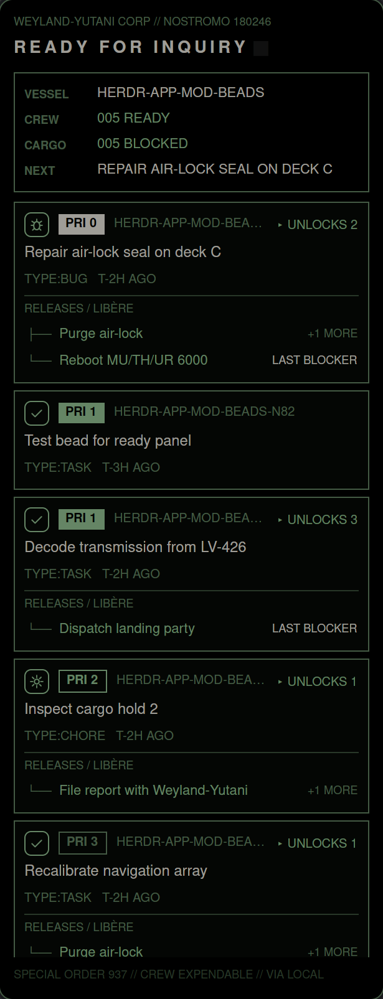

# Nostromo Ready Beads

A panel on the right edge of the herdr-app window that lists the **ready beads** of the project in the focused pane
as the MU/TH/UR 6000 terminal of *Alien* (1979): black glass, sage-green phosphor, Helvetica title cards, a boot
sequence, and now and then an electric shock that tears the picture. Each bead shows what it would release; blocked
beads sit in a framed bay below. Clicking a bead opens a record with its full dependency chain and a button that
spawns a vega sentinel for it.

This is a **layout plus two mods**: `layouts/main-beads.json` (the shipped `main` layout with one extra block),
`mods/beads-ready/` (the panel) and `mods/beads-detail/` (the dialog the panel opens).

## What you see

The panel is a block at the right end of `work-body`, **320 px** wide (min 220, max 700, resizable), `surface`
background, `border` 1 px, radius 10. Inside, the mod paints its own frame: background `#000000`, 1 px border
`#698b69`, radius 12, padding 12, gap 8, text 13 px, font `Nimbus Sans`.

Top to bottom:

1. **Header.** Line 1, 10 px `#698b69`: `WEYLAND-YUTANI CORP // NOSTROMO 180246`. Line 2, 15 px semibold `#f4f1e8`:
   `READY FOR INQUIRY` with a thin space between every letter, followed by a blinking `█` (opacity 0.1 to 1, 900 ms).
2. **Inventory card**, 1 px `#698b69` border, padding 8. Four rows, label 10 px semibold `#698b69` in a 54 px column,
   value 12 px: `VESSEL` (project folder name, upper case, `#f4f1e8`), `CREW` (`005 READY`, `#9bcd9b`),
   `CARGO` (`005 BLOCKED`, `#9bcd9b`), `NEXT` (title of the first ready bead, upper case, `#f4f1e8`).
3. **Ready cards**, one per bead, in a vertical scroll list with 6 px gap. A card has background `#060906`,
   1 px border `#698b69`, padding 8. Row 1: a 22 px **type icon** in a rounded 6 px box (border and glyph `#9bcd9b`),
   a **priority badge**, the bead id in 11 px `#698b69` (truncated), and on the right `▸ UNLOCKS n` in `#9bcd9b`
   when other beads depend on it, directly or transitively. Row 2: the title in `#f4f1e8`, wrapped. Row 3: meta,
   11 px `#698b69`, `TYPE:TASK   OPR:<assignee>   T-<age>` in capitals (`T-2H AGO`). Then, if the bead releases
   others, a 1 px rule `#3d553d`, the label `RELEASES / LIBÈRE` (10 px), and up to four tree rows `├─` / `└─` with the
   title (12 px `#9bcd9b`, truncated) and a right-aligned note (`LAST BLOCKER` in `#f4f1e8`, or `+n MORE` in
   `#698b69`). More than four: `└─ +n MORE`.
4. **Blocked bay**, below the ready cards: a 2 px `#698b69` frame, padding 6, margin-top 8. Inside: a 10 px hazard
   strip of `▚` glyphs in `#3d553d`, then an inverse title bar (background `#698b69`, text `#000000`, 11 px semibold)
   `BLOCKED QUEUE / FILE BLOQUÉE` with the count `005` on the right, then the blocked cards. They look like ready
   cards but have a `#3d553d` border, dimmed titles (`#698b69`) and a `WAITS ON / ATTEND` tree whose notes read
   `READY`, `BLOCKED` or `ACTIVE`.
5. **Footer**, 10 px `#3d553d`: `SPECIAL ORDER 937 // CREW EXPENDABLE // VIA LOCAL` (or `VIA TOOLBOX <name>`).

**Priority badge** (`PRI n`, 11 px semibold): P0 filled `#f4f1e8` with black text, P1 filled `#9bcd9b` with black
text, P2 1 px `#9bcd9b` outline and text, P3 and lower 1 px `#698b69` outline and text. Hue never encodes
priority.

**Type icons** (Ron Cobb "semiotic standard": a pictogram in a rounded rectangle, 24 px stroke SVGs tinted with the text
colour): task = check mark, bug = beetle, feature = four-point star, chore = cog, epic = three stacked layers,
spike = lightning bolt, anything else = circle with exclamation mark.

**The record dialog** (opened by a click, 620 px wide, 82 % high, centred, dimming the window): black, 1 px
`#698b69` border, padding 14. A header with `MU/TH/UR 6000 // RECORD` and, on the right, an optional `◂ BACK` button
and the close button (an alien-head glyph in a 1 px box). Then the priority badge and the bead id, the title in 18 px,
a **sentinel button** (pixel skull, `SPAWN VEGA SENTINEL`, `FOR THIS BEAD / POUR CE BEAD`), status / type / owner /
assignee / dates / labels as small captioned fields, description, design, acceptance criteria and notes in
`Noto Serif`, and two trees: `WAITS ON / ATTEND // n IN CHAIN` (everything it transitively waits on) and
`RELEASES / LIBÈRE // n IN CHAIN` (everything it transitively releases). Each tree row: box-drawing prefix in
`JetBrains Mono`, `Pn` box, title, status.

## How it behaves

- **Start.** For about 1.7 s the panel types out `> WEYLAND-YUTANI CORP`, `> NOSTROMO 180246`,
  `> MU/TH/UR 6000 ONLINE`, `> READING WORK QUEUE` (one line every 380 ms, the newest in `#f4f1e8`), then shows the
  queue.
- **Follows focus.** It reads the working directory of the focused pane (or the active space's folder) and runs
  `beads` there. A cheap check every 1.5 s notices a changed folder and refreshes at once; otherwise it refreshes every
  5 s. It only redraws when the data changed.
- **Missing or old beads.** No `beads` found: a boxed `!! NO CONNECTION !!` with
  `` `BEADS` NOT FOUND ``. Version below 1.3: the same box with `BEADS >= 1.3 REQUIRED, FOUND: <version>`. Nothing else
  happens. A failing `beads ready` (for example no database): `!! SYSTEM FAULT !!` with the first `Error:` line.
  Nothing ready and nothing blocked: `> NO ACTIONABLE ENTRIES. ALL QUIET.`
- **Clicks.** A card or a row of a `RELEASES` / `WAITS ON` tree opens the record for that bead. Hovering turns a card's
  border orange `#ffa500` and its background `#0d140d`. Inside the record: a tree row opens that bead (with `◂ BACK`
  and `Backspace` to return), `Esc` closes, the bead id copies itself to the clipboard (shows `✓ COPIED <ID>` for 1.4 s),
  the alien-head button closes the view (tooltip `close view`).
- **Sentinel.** Click the skull: a confirmation box with an orange border appears (`VERIFY / VÉRIFIER`, a sentence in
  the serif, `PUSH` filled cream, `PULL` outlined). `PUSH` runs `vega mux spawn`, shows `> ENGAGING…`, then
  `> SENTINEL ONLINE: …` or `!! SPAWN FAILED: … !!`, and posts a notification. The button is only drawn when `vega`
  runs.
- **Shock.** First 8 to 12 s after start, then every 25 to 70 s (in 25 % of cases a second one follows after 0.6 to
  1.5 s): 12 frames of 55 ms with strengths `1, .35, 1, .15, .7, .45, .9, .25, .5, .15, .3, .08`. Per frame, rows are
  shifted sideways by up to `34 * strength` px, about `12 % * strength` of the characters become one of `▒░█▓#%/\|<>_=+*`,
  the panel's opacity drops to `0.78 + 0.22 * (1 - strength)`, the first line reads `!! POWER SURGE // BUS 4 !!` above
  strength 0.6, and frames 0 and 2 (and frame 6 half of the time) invert the palette to a light sage background with
  black text. `herdr-app do beads-ready.shock` fires one on demand.

## Built from

- **Layout** `layouts/main-beads.json`: the shipped `main` layout (cloned from version 0.1.13) with one more child of
  `work-body`, after `panel`:
  `{ "id": "beads", "type": "block", "size": { "px": 320 }, "min": 220, "max": 700, "background": "surface",
  "border": { "width": 1, "color": "border" }, "radius": 10, "content": { "mod": "beads-ready" } }`.
  Everything else comes from `main`: the `spaces`, `agents`, `workspace-chrome`, `tabs`, `pane`, `files`, `changes`
  and `workspace-status` mods.
- **`mods/beads-ready/`** (`mod.json`: `{ "place": "right", "size": 320 }`, `main.js`, `icons/*.svg`): one `View`.
  `init` starts three timers (`cx.timer.every` 5000 ms refresh, 1500 ms watch, `cx.timer.after` chain for the boot
  and the shock frames) and a `cx.spawn` loop on `nextCommand()` for `shock` and `close`. `refresh` calls
  `exec` for `beads --version`, `beads ready --json --limit 0` and `beads blocked --json`. The graph comes from
  `blocked_by` in the blocked list: dependents are the blocked beads that name a ready bead, downstream counts are a
  breadth-first walk. Props `{ cwd, on? }` pin it to one folder instead of the focused pane.
- **`mods/beads-detail/`** (`mod.json`: `{ "place": "none" }`, `main.js`, `skull.svg`, `alien.svg`): opened with
  `openOverlay({ mod: "beads-detail", kind: "dialog", width: 620, height: 0.82, props: { id, cwd, on, runner } })`.
  It runs `beads show <id> --json` and `beads dep tree <id> --direction down|up --json` (flat rows with `depth` and
  `parent_id`, rebuilt into a tree, a bead reached twice shows once). The sentinel button writes a brief to
  `<app home>/data/beads-sentinel/<id>.md` and runs
  `vega mux spawn sentinel-<last id segment> --kind claude --tier balanced --no-parent --prompt-file <brief> --cwd <dir>`.
- **herdr functions**: `spaces`, `panes`, `focused`, `exec`, `openOverlay`, `closeOverlay`, `nextCommand`, `props`,
  `notify`, `appHome`, `readTextFile`, `writeTextFile`; `cx.write_to_clipboard`, `cx.timer`, `cx.spawn`, `cx.notify`.
- **Programs**: `beads` (>= 1.3), optionally `vega`, `env`, `mkdir`, and `toolbox` if configured.
- **Fonts** (installed, not bundled): `Nimbus Sans`, `Noto Serif`, `JetBrains Mono`.
- **Palette** (b4mad.industries): `#000000` black, `#060906` card, `#698b69` sage, `#9bcd9b` light sage, `#f4f1e8`
  cream, `#3d553d` dim, `#ffa500` hover; during a shock flash: `#9bcd9b` background, `#c9e6c9` card, `#000000` text.
- **Art**: `skull.svg` (16x12 pixel skull with horns, `crispEdges`), `alien.svg` (28x14 side profile of an elongated
  head with a fanged snout), seven 24 px stroke type icons.
- **Optional config** `<app home>/data/beads-ready/config.json`: `{ "toolbox": "<container>", "unsetEnv": ["VAR", …] }`.

## Watch out

- `herdr-app check` renders a mod once without props. The dialog therefore has to cope with `props()` being empty
  (it shows `No record selected`).
- The shipped `main` layout is read-only and never docks the mod by itself; the layout file here is a clone and is
  not updated when herdr changes `main`.
- `beads` run through the app inherits the app's environment. A `BEADS_DOLT_SHARED_SERVER` set there makes the local
  `beads` look for the database on a Dolt server instead of the project's `.beads`; `unsetEnv` exists for that.
- `beads ready` stops at 100 beads by default, so the mod passes `--limit 0`.
- Timers keep running while the panel is hidden; the poll is cheap but not free.
- The sentinel is started with `--no-parent` (a click has no parent agent pane), so vega does not track it. vega's
  Claude defaults skip permission prompts, hence the `PUSH` / `PULL` step.
- A shock redraws the panel about 18 times per second for 0.7 s; do not shorten `FRAME_MS` much.
- Do not rely on colour for status or priority: red, yellow, green and blue belong to status elsewhere in herdr.
- `Alien`, `Nostromo`, `MU/TH/UR` and `Weyland-Yutani` belong to their owners; the names are homage only.

## Done when

- `herdr-app check` passes for `mods/beads-ready` and `mods/beads-detail`, and `herdr-app status` lists no errors.
- With `main-beads` active and a pane in a folder with a beads database, the right edge shows the boot lines, then the
  header, the inventory card, ready cards and the blocked bay, as in `preview.png`.
- Creating a bead with `beads create` makes it appear within about 5 s without touching the panel.
- A bead that blocks another shows `▸ UNLOCKS 1` and a `RELEASES / LIBÈRE` row with `LAST BLOCKER`; the blocked bead
  sits in the bay with `WAITS ON / ATTEND`.
- Moving focus to a pane in a folder without a database shows `!! SYSTEM FAULT !!` and no list; a `beads` older than
  1.3 shows `!! NO CONNECTION !!` with the version.
- Clicking a card opens the record; clicking a tree row opens that bead and `◂ BACK` returns; the bead id copies on click;
  the alien-head button (tooltip `close view`) closes it.
- `herdr-app do beads-ready.shock` visibly tears and flashes the panel for under a second and it recovers.
- Without `vega` the skull button is absent; with it, `PUSH` starts a sentinel and `PULL` does nothing.
